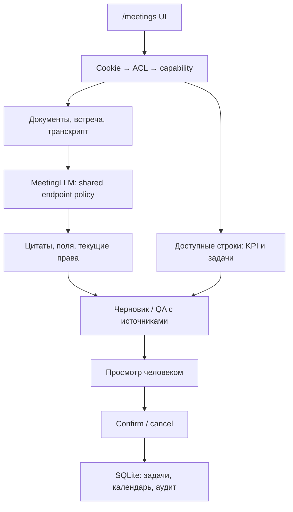

# Архитектура и потоки Track 3

Ядро регистрирует роутеры knowledge/management при наличии модулей. Миграции
выполняет только meetings/migrations, version 8. UI использует серверные capabilities,
не определяет их по должности. ACL проверяется перед ролью и сборкой контекста,
после долгой генерации и при открытии источника. Отказы журналируются отдельной
транзакцией; ошибки не раскрывают названия чужих объектов.

LLM не имеет инструментов, не подтверждает задачи и не отправляет приглашения.
Один gateway-policy владеет выбором адреса, Bearer и допустимым transport.
Тексты модели проходят серверную проверку цитат/имён/сроков. Это не доказывает
семантическую правильность или полноту: их измеряет отдельный frozen evaluator.

Task preview связан с пользователем, объектом и version. Confirm в write_tx
повторяет ACL/проверки и использует idempotency_key. Cancel не меняет объект,
но запись preview может храниться до очистки. Calendar provider=mock:
события/приглашения только SQLite local_outbox, SMTP не вызывается.

Обзор использует доступные строки производственного среза; KPI — отношение сумм
числителей/знаменателей. Нулевой знаменатель=null, дата источника консервативная.
Статусы задач текущие; исторический as_of не восстанавливает историю статусов.
Метрики не генерируются моделью. Resolver повторяет доступ/целостность источников.

## Границы

Диск: SQLite и session secret без шифрования приложением. Loopback inference —
на сервере приложения; remote gateway — на другой машине. При туннеле Cloudflare
участвует внешний посредник. Текстовый запуск обходит необходимость речевых весов
через существующую ленивую загрузку, не меняет ASR или app.py и не скрывает
недоступность голосовых функций. Речевой tract и реальные клиентские встречи
не являются измерением этого выпуска.
