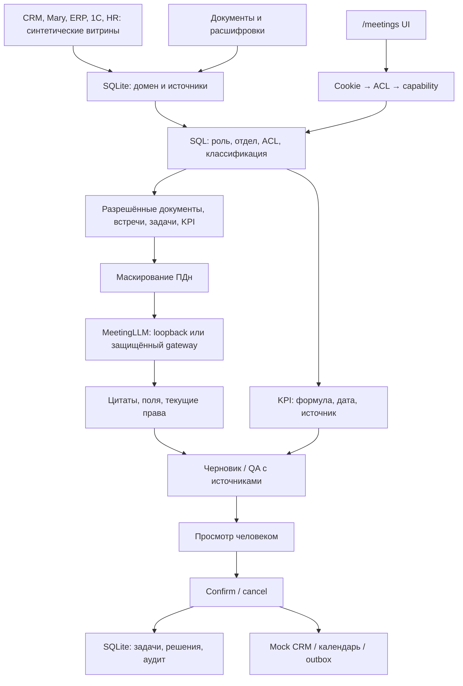

# Архитектура и потоки Фокус v2

Ядро регистрирует роутеры knowledge/management при наличии модулей. Миграции
выполняет только meetings/migrations: v9 — домен/роли/витрины, v10 — контроль
решений, v11 — integration outbox/mock CRM. UI использует серверные capabilities,
не определяет их по должности. ACL проверяется перед ролью и сборкой контекста,
после долгой генерации и при открытии источника. Отказы журналируются отдельной
транзакцией; ошибки не раскрывают названия чужих объектов.

LLM может выбрать только read-tool и серверный candidate ID из allowlist.
Подтверждение задач и отправка приглашений выполняются отдельным human-confirmed API.
Один gateway-policy владеет выбором адреса, Bearer и допустимым transport.
Тексты модели проходят серверную проверку цитат/имён/сроков. Это не доказывает
семантическую правильность или полноту: их измеряет отдельный frozen evaluator.

Task preview связан с пользователем, объектом и version. Confirm в write_tx
повторяет ACL/проверки и использует idempotency_key. Cancel не меняет объект,
но запись preview может храниться до очистки. Calendar provider=mock:
события/приглашения по умолчанию SQLite local_outbox. SMTP — отдельный preview/confirm и durable smtp_outbox, только за флагами.

Обзор использует доступные строки производственного среза; KPI — отношение сумм
числителей/знаменателей. Нулевой знаменатель=null, дата источника консервативная.
Статусы задач текущие; исторический as_of не восстанавливает историю статусов.
Метрики не генерируются моделью. Resolver повторяет доступ/целостность источников.

## Границы

Диск: SQLite и session secret без шифрования приложением. Loopback inference —
на сервере приложения; remote gateway — на другой машине. При туннеле Cloudflare
участвует внешний посредник. Текстовый запуск обходит необходимость речевых весов
через существующую ленивую загрузку, не меняет ASR или app.py и не скрывает
недоступность голосовых функций. Речевой tract и реальные клиентские встречи
не являются измерением этого выпуска.

## Продолжение E3–E12

Миграции12–19: ICS, версии, assistant/evidence, operations, protocol mail,
calendar-provider outbox, media/calls и action_basis. Backend аудио загружается
только при явном pipeline flag; по умолчанию файл сохраняется с503. Диаризация
даёт метки, человек сопоставляет участников; импорт append preview/confirm.
Аналитика звонков детерминирована и цитатна, фактическое качество модели отдельно.

Внешний календарь: freeze provider/mapping → confirm/current busy → commit
reservation+pending token result → commit sending → HTTP → sent либо uncertain.
При аварии повтор sending становится uncertain, без повторного HTTP; слот
сохраняется. Локальные приглашения возникают только после известного успеха.

Retained sources и audit связывают действие с подтверждающим. Метрика/звонок
могут стать basis новой встречи/поручения: source hash и права перепроверяются
перед записью, ссылку хранит action_basis. Default CRM/ERP/Mary — scoped mocks;
Bitrix REST и calendar gated, всё тестировалось на транспортных дублёрах.

Миграции21–22: seasonality/pickup projection, weekly digest/effect checks и
reviewed delivery. Worker: retention+internal notifications+effect checks в
транзакции; внешняя доставка claim→commit→HTTP/SMTP→status, вне write-lock.
Отключённые каналы не вызывают сеть. Источники расчётов HMAC с текущим ACL.
